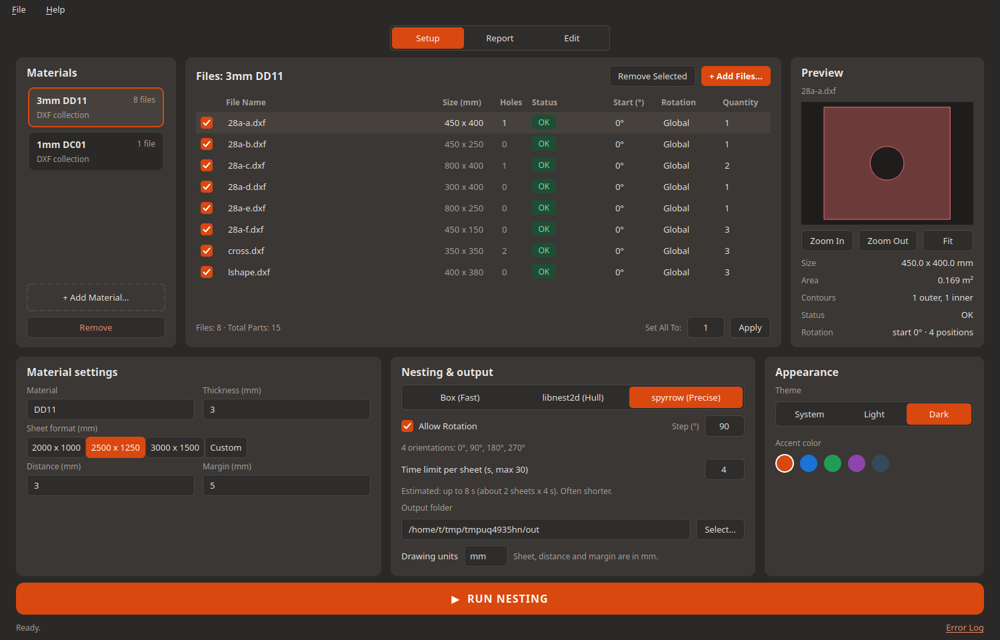
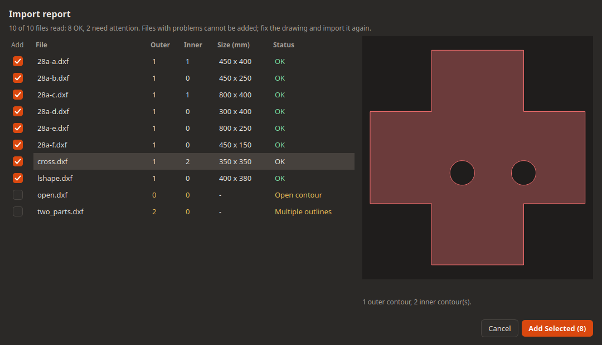
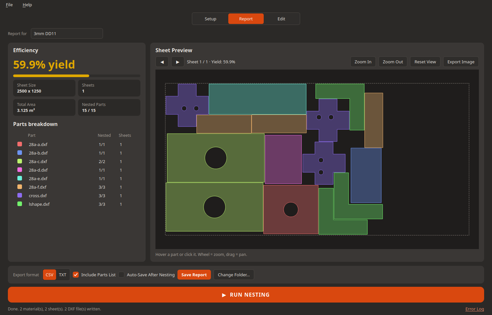
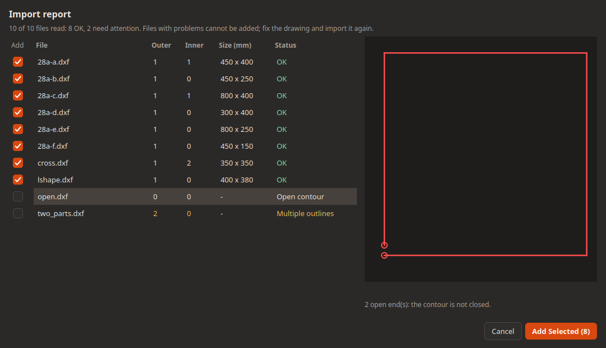
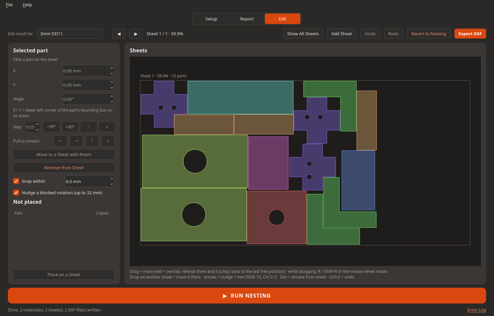

# SimpleNesting

**Quick nesting in a few clicks** — for anyone in the final project phase who needs to **instantly see material usage** and whether
**small dimension changes can save significant material**. Made for people who have to **get a cutting plan for production right now** —
**a few clicks to the result**: load the parts, press one button, and the plan is on the screen. And for those who love the details:
**every parameter is open** — quantities, start angle, rotation step, margin, spacing, sheet format, engine, time limit — nothing is hidden.

- Load DXF parts → pick an algorithm → hit *Run Nesting* → get the sheet layouts + a CSV report
- **3 nesting algorithms** (Box, No-Fit Polygon libnest2d, sparrow) — try them all fast and compare the yield %
- **Compare algorithms side-by-side**: Box, No-Fit Polygon libnest2d, sparrow — same parts, same sheet, instant yield comparison
- **Fast GUI engine** for experimentation: tweak the sheet size, margins, spacing, rotations — instant feedback
- **Everything adjustable for the detail-oriented**: quantities, start angle, rotation step, margin, spacing, sheet format, time limit, engine
- **Manual editing (Edit tab)**: after the algorithm, the human adds the final touch — drag, rotate and snap parts to improve on the automatic result

**GUI**: PySide6 (Qt 6). A robust desktop application for 2D nesting and optimization tailored for sheet and coil cutting machines — including laser, plasma, waterjet, punching, and roll-fed systems.

## Screenshots

| Setup | Import report | Result |
|---|---|---|
|  |  |  |

*Problem files are flagged in the import report: an open contour with its free ends in red.*



*The Edit tab: every sheet of the result on one canvas, parts moved and turned by hand.*



The screenshots are generated by the real GUI: `python -m tests.gui_smoke docs/screenshots`.

## Run

```bash
python3.12 -m venv .venv
source .venv/bin/activate          # Windows: .venv\Scripts\activate
pip install -r requirements.txt    # Linux with Qt 6.5+ also needs: sudo apt install libxcb-cursor0
python main.py
```

### Ready-to-run program (no Python needed)

The **Releases** page has a ready-to-run program for Windows and Linux. Unpack the archive and start the program inside the
folder: `simplenesting` (Windows: `simplenesting.exe`). The whole folder belongs together - it is not a single file, because PySide6 and
libnest2d are LGPL and must stay replaceable.

To build it yourself:

```bash
pip install pyinstaller
python build.py --clean            # the result is in dist/simplenesting/
```

A GitHub tag (`v1.0.0`) builds the program for all three systems and attaches the archives to the release automatically.

On a fresh start the app shows what to do first: the **"+ Add Material..."** button blinks 5 times within 1.5 s (each flash looks
exactly like the mouse-over state of the button) and the status bar
says *"Start here: click '+ Add Material...' to create your first material."*. The hint is skipped when the project already has materials
(opened project, restored autosave).

## Quick start

1. **"+ Add Material..."** — name the plate (e.g. *3mm DD11*), set its thickness, sheet format, margin and spacing.
2. **"+ Add Files..."** — pick the DXF parts; set the quantity of each one. The import report shows what was read and what is wrong.
3. Pick the **engine** (Box / libnest2d / spyrrow) and the rotation step.
4. **▶ RUN NESTING** — the Report tab shows the sheets, the yield % and the parts per sheet.
5. **Export DXF** — one file per sheet, with the plate outline in red; plus a CSV report.

To see what parts ended up on which sheet, open the **Report** tab. Each sheet row shows the nested layout, the sheet dimensions,
the yield %, and the list of parts on that sheet.

## Features

### Import & validation
- DXF files are read with **ezdxf** — true arcs, circles, ellipses, splines, polylines.
- Import report validates: open contours (free ends marked), self-intersections, multiple outlines, degenerate edges, tiny edges.
- Each part can have its own quantity, start angle, rotation step, and allowed rotations.

### Three nesting engines
| Engine | Best for | Notes |
|---|---|---|
| **Box** | Simple rectangular parts, fast iteration | Axis-aligned bounding box packing; extremely fast |
| **libnest2d** | Convex shapes, production use | Uses NFP (no-fit polygons); LGPL; **convex only** — concave parts are nested as their convex hull |
| **spyrrow** | Concave parts, maximum yield | Exact polygon placement via SAT; solves strip packing; MIT licence |

### Per-part rotation control
- Global rotation step (e.g. 90°) plus per-part **Start angle** and **Rotation step**.
- libnest2d: the algorithm receives a list of allowed orientations; spyrrow maps them directly.

### Post-nesting validation
After every run, **shapely** re-checks:
- No overlaps between parts
- All parts respect the sheet margin
- All parts are inside the sheet boundary

Any violation is reported in the GUI.

### Manual editing (Edit tab)
- All sheets on one infinite canvas.
- Drag parts, rotate (90° or free), snap to other parts or sheet edges.
- Undo/Redo, delete, duplicate.
- Changes are reflected in the Report tab and in exported DXF/CSV.

### Project files
- `.snest` project file (JSON) stores materials, parts, quantities, engine settings, and results.
- Autosave on every run; dirty flag in window title.
- File → Open / Save / Save As / Recent files.

## Tests

```bash
# Unit / logic (no Qt)
python -m tests.test_nesting_engines
python -m tests.test_dxf_geometry
python -m tests.test_project       # project files: round trip, relink, stale results (no Qt)
python -m tests.test_orientation   # start angle, per-part step, libnest2d mapping, spyrrow orientations

# GUI tests (headless Qt, QT_QPA_PLATFORM=offscreen)
python -m tests.test_orientation_gui # Start/Rotation columns, context menu, a real run (headless Qt)
python -m tests.test_project_gui   # File menu, dirty flag, autosave, hover links (headless Qt)
python -m tests.test_controller    # real worker process, progress, cancel, watchdog, 30 s cap
python -m tests.gui_smoke /tmp/shots   # drives the GUI headless (QT_QPA_PLATFORM=offscreen), writes screenshots
```

## Known limitations

- Spacing 0: libnest2d / Box use at least 0.01 mm (with exactly 0 they placed parts on top of each other). Common-line cutting (merging shared edges) is
  deliberately not implemented: it only pays off for straight, exactly aligned edges and conflicts with kerf compensation and closed contours.

- **libnest2d's NFP placer is only correct for convex shapes** (tested: crosses and L-shapes overlap), so the libnest2d engine nests convex hulls. Use spyrrow for concave parts. Parts are never nested into holes of other parts (neither engine supports it).
- spyrrow solves strip packing; sheets are filled one after another (parts beyond the sheet width move to the next sheet). Cancel during a solve ends the worker, finished materials are kept.
- After nesting, shapely re-checks the layout (overlaps, margin) and the GUI warns if anything is wrong.
- DXF `INSERT` (blocks), TEXT and hatches are ignored; only LINE, ARC, CIRCLE, ELLIPSE, LWPOLYLINE, POLYLINE, SPLINE are read.
- A DXF file must contain one outline (plus holes). Several separate outlines are flagged "Multiple outlines".
- python-libnest2d is LGPL-3.0 and PySide6 is LGPL-3.0: keep that in mind when distributing PyInstaller builds (use `--onedir`).

## Third-party libraries

SimpleNesting stands on the shoulders of these projects - thanks to all of them:

| Library | Version | Author / project | Licence | Used for |
|---|---|---|---|---|
| [PySide6](https://pyside.org) (Qt 6) | 6.12 | Qt for Python Team, The Qt Company Ltd. | LGPL-3.0-only OR GPL-2.0/3.0 | the whole GUI |
| [ezdxf](https://github.com/mozman/ezdxf) | 1.4.5 | Manfred Moitzi | MIT | reading and writing DXF (true arcs, splines) |
| [python-libnest2d](https://github.com/HamzaYslmn/python-libnest2d) | 0.1.3 | Ultimaker B.V. (original *pynest2d*) and the python-libnest2d contributors | LGPL-3.0-or-later | the *Box* and *libnest2d* engines |
| [spyrrow](https://github.com/PaulDurandLupinski/spyrrow) | 0.9 | Paul Durand-Lupinski (Reeverse Systems) | MIT | the *spyrrow* (precise) engine |
| [shapely](https://shapely.readthedocs.io) | 2.2 | Sean Gillies and the GEOS project | BSD-3-Clause | geometry, overlap and margin checks, manual editing |
| [pyclipper](https://github.com/fonttools/pyclipper) | 1.4 | Angus Johnson, Maxime Chalton, Lukas Treyer, Gregor Ratajc | MIT | polygon offsetting (clipping) |
| [numpy](https://numpy.org) | 2.5 | Travis E. Oliphant et al. | BSD-3-Clause | arrays (through ezdxf) |
| [fontTools](https://github.com/fonttools/fonttools) | 4.67 | Just van Rossum et al. | MIT | font handling (through ezdxf) |
| [pyparsing](https://github.com/pyparsing/pyparsing) | 3.3 | Paul McGuire | MIT | parsing (through ezdxf) |

The ready-to-run builds keep the licences of these libraries; the licence texts are in the `licenses` folder of the program.
Because PySide6 and python-libnest2d are LGPL, the program is distributed as a **folder** (`--onedir`), never as a single file.

## Credits

SimpleNesting was written with [Claude](https://claude.ai) (Anthropic) as the AI pair programmer - the code, the GUI, the tests and this
documentation.
